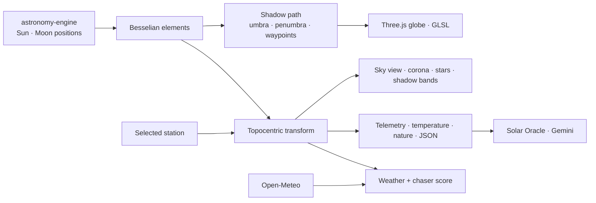

<div align="center">


<p>
  
  
  
  
</p>

<p><em>Europe's first total solar eclipse in 27 years, simulated with real orbital mechanics.<br>
Watch the Moon's shadow cross the Arctic, Greenland, Iceland and Spain on 12 August 2026, then plan where to stand.</em></p>

</div>


## Second by second, station by station

Solar Eclipse 2026 follows the umbra and penumbra across the Earth one second at a time. Pick an observing station and you get its live solar altitude and azimuth, obscuration, temperature drop and the exact length of totality, with the corona, the diamond ring and Baily's beads drawn in a horizon view of that station's sky.

The path is laid out along waypoints from the umbra's first contact over the Arctic Ocean, across the Greenland ice sheet and the Denmark Strait, to the point of greatest eclipse off western Iceland (2 m 18 s of totality) and on to Spain. Eight stations are ready to pick, from Scoresby Sund and Reykjavík to Bilbao, Madrid, Zaragoza, Barcelona, Valencia and Palma.

> **Every orbit and timing is computed.** The simulator uses Besselian elements, ephemeris from `astronomy-engine` and topocentric horizon transforms. Nothing about where the shadow falls is hand-placed.


## Features

| | |
|---|---|
| **3D Earth (WebGL)** | A custom GLSL shader with Rayleigh scattering, the day–night line and the projected umbra, with its own Sun, Moon and corona shaders. |
| **Live sky view** | The Sun–Moon overlap at the station's horizon angle, with the diamond ring and Baily's beads. |
| **Corona and bloom** | A layered plasma corona that switches on above 95 % obscuration and at totality. |
| **Stars at totality** | The Summer Triangle, Venus, Jupiter, Mars and the Milky Way appear from a bright-star catalogue. |
| **Shadow dynamics** | The shadow's ground speed in km/h and km/s, and the precise totality duration at your point. |
| **Temperature drop** | A micro-climate chart from altitude, humidity and lost solar radiation. |
| **Nature panel** | The light level as it falls toward twilight, and how birds, bees, insects and flowers respond as it does. |
| **Shadow bands** | Faint ripples across the ground just before and after totality, oriented perpendicular to the Sun's azimuth. |
| **Time machine** | One-second resolution up to 60× speed, C1–C4 contact times, a path timeline and autoplay. |
| **Clocks** | Local time in Greenland (UTC−1), Iceland (UTC) and Spain (CEST) side by side with UTC. |
| **Camera modes** | Free orbit, North Pole, top-down, and Iceland / Spain tracking. |
| **Telescope viewfinder** | A solar viewfinder that turns pitch black at totality, with the planets placed where they will be. |
| **Weather** | Open-Meteo forecasts for the station on the day, turned into a clear-sky probability. |
| **Chaser planner** | Ranks stations with a 0–100 score from August clear-sky climatology, totality duration and Sun altitude. |
| **Plan and keep** | Add the eclipse to your calendar (`.ics`), read a photography guide, record the canvas to video, and print an observation certificate. |
| **Solar Oracle** | An optional Gemini assistant that answers eclipse questions with the live telemetry as context. |
| **Telemetry export** | Download a station's contact times, GPS coordinates and durations as JSON. |
| **Sound** | An optional ambient soundscape synthesised with Web Audio. |


## Choosing where to stand

The planner scores every station from three things you cannot change on the day:

| Input | Why it matters |
|---|---|
| **Clear-sky probability** | August climatology from Open-Meteo. A long totality behind clouds is nothing. |
| **Totality duration** | Seconds of darkness at that point, from the Besselian path. |
| **Sun altitude** | In Spain the Sun sets soon after totality; a low Sun means a clear western horizon is essential. |

The result is a single composite chaser score from 0 to 100, with the inputs shown beside it.


## How it works




## Türkçe özet

**Solar Eclipse 2026**, 12 Ağustos 2026'daki tam Güneş tutulmasının 3B simülatörü. Ay gölgesinin Kuzey Kutbu, Grönland, İzlanda ve İspanya üzerinden geçişini saniye saniye izleyebiliyorsun. Bir gözlem noktası seçince Güneş yüksekliği, örtünme yüzdesi, sıcaklık düşüşü ve tam tutulma süresi canlı hesaplanıyor; gökyüzü görünümünde korona, elmas yüzük ve Baily boncukları beliriyor. Open-Meteo hava tahmini, 0–100 puanlı "nerede izlemeli" planlayıcısı, takvime ekleme, fotoğraf rehberi ve isteğe bağlı bir Gemini asistanı da var. Güneş'e asla korumasız bakma.


## Development

```sh
npm install
cp .env.example .env.local   # optional: GEMINI_API_KEY for the Solar Oracle
npm run dev                  # http://localhost:3000
npm run build
npm run lint                 # tsc --noEmit
```

Without a Gemini key the simulator works fully; only the assistant stays off.

```
src/components/   globe and shaders (Earth, Sun, Moon, sky), sky view, panels, charts, modals
src/utils/        shadow maths, topocentric transforms, weather, calendar export, audio, i18n
src/data/         eclipse elements, path waypoints, stations, milestones, star catalogue
public/textures/  Earth and Moon maps
```

<div align="center">
<br>
<a href="https://github.com/kutluhangil"></a>
<sub>Eclipse data after NASA GSFC · ephemeris by astronomy-engine · weather by Open-Meteo · never look at the Sun without proper eye protection · values in the banner are illustrative.</sub>
</div>
