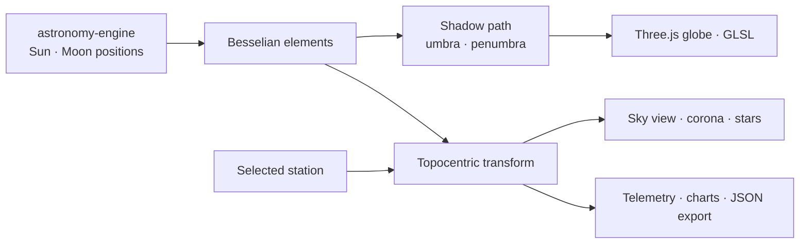

<div align="center">



<p>
  
  
  
  
</p>

<p><em>Europe's first total solar eclipse in 27 years, simulated with real orbital mechanics.<br>
Watch the Moon's shadow cross the Arctic, Greenland, Iceland and Spain on 12 August 2026.</em></p>

</div>


## What it is

Solar Eclipse 2026 follows the umbra and penumbra across the Earth second by second. Pick an observing station and you get its live solar altitude, obscuration, temperature drop and the exact length of totality, with the corona, the diamond ring and Baily's beads in a horizon view.

> **Every orbit and timing is computed.** The simulator uses Besselian elements, NASA/JPL DE440-based ephemeris and topocentric horizon transforms.


## Features

| | |
|---|---|
| **3D Earth (WebGL)** | A custom GLSL shader with Rayleigh scattering, the day–night line and the projected umbra. |
| **Live sky view** | The Sun–Moon overlap at the station's horizon angle, with the diamond ring and Baily's beads. |
| **Corona and bloom** | A layered plasma corona that switches on above 95 % obscuration and at totality. |
| **Star catalogue** | The Summer Triangle, Venus, Jupiter, Mars and the Milky Way appear during totality. |
| **Shadow dynamics** | The shadow's ground speed in km/h and km/s, and the precise totality duration at your point. |
| **Micro-climate** | A temperature-drop chart from altitude, humidity and lost solar radiation. |
| **Time machine** | One-second resolution up to 60× speed, C1–C4 contact times and autoplay. |
| **Camera modes** | Free orbit, North Pole, top-down, and Iceland / Spain tracking. |
| **Telemetry export** | Download a station's contact times, GPS coordinates and durations as JSON. |


## How it works




## Türkçe özet

**Solar Eclipse 2026**, 12 Ağustos 2026'daki tam Güneş tutulmasının 3B simülatörü. Ay gölgesinin Kuzey Kutbu, Grönland, İzlanda ve İspanya üzerinden geçişini saniye saniye izleyebiliyorsun. Bir gözlem noktası seçince Güneş yüksekliği, örtünme yüzdesi, sıcaklık düşüşü ve tam tutulma süresi anlık hesaplanıyor; korona, elmas yüzük ve Baily boncukları gökyüzü görünümünde beliriyor. Hesaplar Besselian elemanları ve efemeris verisiyle yapılıyor.


## Development

```sh
npm install
cp .env.example .env.local   # optional Gemini key for the AI guide
npm run dev                  # http://localhost:3000
npm run build
npm run lint                 # tsc --noEmit
```

```
src/components/   globe, sky view, panels, charts, timeline
src/utils/        Besselian maths, shadow path, topocentric transforms
src/data/         stations and eclipse elements
```

<div align="center">
<br>
<a href="https://github.com/kutluhangil"></a>
<sub>Eclipse data after NASA GSFC · ephemeris by astronomy-engine. Never look at the Sun without proper eye protection.</sub>
</div>
